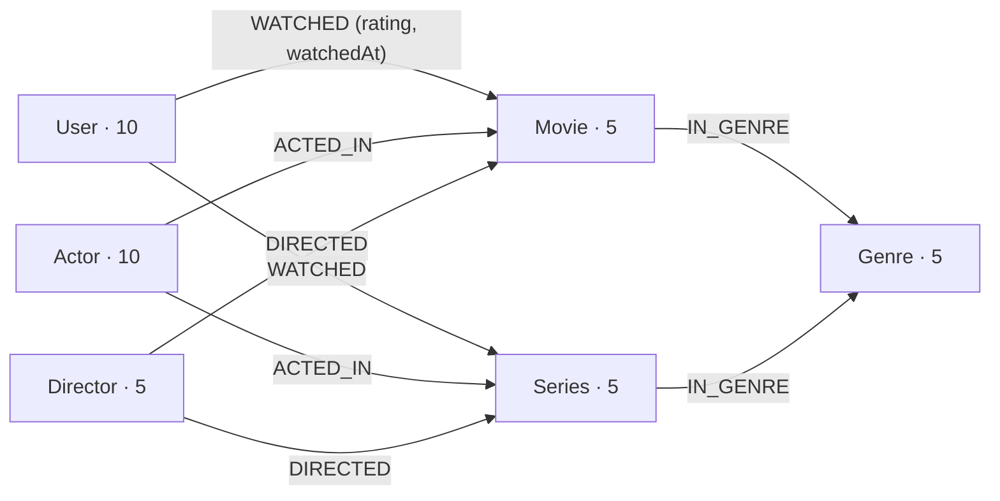

# DIO — Streaming Knowledge Graph (Neo4j)

Solução independente do desafio DIO, criada dentro do fork do exemplo oficial [Neo4j Recommendations](https://github.com/neo4j-graph-examples/recommendations). Os dados são **fictícios** e foram elaborados apenas para demonstrar modelagem e consultas de recomendação.

## Problema e justificativa

Uma plataforma de streaming precisa representar conexões entre usuários, filmes, séries, atores, diretores e gêneros. O banco de grafos permite percorrer essas relações para encontrar afinidades entre conteúdos e usuários, sem reproduzir manualmente múltiplas junções relacionais.

## Aprenda a reconstruir sem IA

Se você quer entender cada decisão e cada comando, leia o **[Curso prático: reconstruir este projeto do zero](docs/CURSO_DO_ZERO.md)**. O guia explica os padrões linha a linha dos scripts de carga, consulta e validação, mostra o fluxo Git/GitHub e inclui exercícios independentes para dominar a modelagem.

## Modelo

| Label | Quantidade | Propriedades |
|---|---:|---|
| User | 10 | id, name |
| Movie | 5 | id, title, year |
| Series | 5 | id, title, year |
| Actor | 10 | id, name |
| Director | 5 | id, name |
| Genre | 5 | id, name |

Relações: `WATCHED` (**50**, propriedade `rating` de 1 a 5, `watchedAt` tipo date), `ACTED_IN` (**30**), `DIRECTED` (**10**), `IN_GENRE` (**20**). São **40 nós e 110 relacionamentos**, totais confirmados em execução manual no Neo4j Aura em 19/11/2026. Os IDs têm unicidade por label, protegida por seis constraints.

## Executar

1. Crie um **banco Neo4j 5.x vazio e exclusivo** no Aura, Desktop ou servidor local. Não importe os dumps do fork original neste banco.
2. Abra o Neo4j Browser e execute [01_modelo_e_carga.cypher](cypher/01_modelo_e_carga.cypher), em ordem. Se o Browser não aceitar várias instruções, execute cada bloco terminado em ponto e vírgula separadamente.
3. Execute [02_verificacao.cypher](cypher/02_verificacao.cypher) e confira os totais. O esperado é zero registros inválidos e seis constraints.
4. Execute individualmente as consultas em [03_consultas_negocio.cypher](cypher/03_consultas_negocio.cypher) para ver rankings, recomendações, preferências e caminhos do grafo.
5. Consulte os [resultados observados no Neo4j Aura](docs/RESULTADOS_EXECUCAO.md) e acrescente as capturas reais em `docs/evidencias/` antes da entrega. **Nenhuma captura de execução foi fabricada.**

O script usa `MERGE` para ser reexecutável sem duplicar os pares de relacionamentos, desde que o modelo esteja no banco dedicado. Não requer APOC nem Graph Data Science.

## Consultas de negócio

- Q1: ranking de filmes e séries por avaliação.
- Q2: recomendação de conteúdos por gêneros bem avaliados.
- Q3: recomendação colaborativa a partir de espectadores com preferências similares.
- Q4: visualização do grafo de preferências de U01.
- Q5: obras agrupadas por diretor.
- Q6: preferências de gênero a partir das avaliações.

As recomendações são regras demonstrativas e não representam um sistema de produção. Com apenas 10 usuários, a amostra serve para explicar os caminhos de recomendação, não para avaliar precisão estatística.

## Validação real em Neo4j Aura — 19/11/2026

- **40 nós e 110 relacionamentos** confirmados.
- **50 avaliações WATCHED, zero inválidas e zero duplicadas**.
- **10 obras e nenhuma sem ator, diretor ou gênero**.
- Recomendação baseada em conteúdo: **Rota 47** liderou com score 14.
- Recomendação colaborativa: **Rota 47** (3 pares, nota média 4,67) e **Quase Férias** (2 pares, nota média 4,00).
- [Relatório detalhado de resultados e evidências](docs/RESULTADOS_EXECUCAO.md).

## Troubleshooting

- **Constraint existente:** `IF NOT EXISTS` torna a criação repetível. Execute em banco exclusivo para não misturar dados.
- **Nenhum resultado na recomendação:** verifique o ID e os limiares de nota; testes com base pequena podem filtrar todas as opções.
- **Erro ao colar o script inteiro:** execute um comando terminado por `;` de cada vez, na ordem dos arquivos.
- **Contagens divergentes:** confirme que o banco estava vazio e que todos os comandos foram executados.
- **Reexecução sem novas linhas:** é comportamento esperado do `MERGE`.

## Entrega e evidências

As evidências necessárias são: seis constraints, contagem de nós, contagem de relacionamentos, grafo da Q4, recomendações Q2/Q3 e verificação de integridade. Capture imagens diretamente no Neo4j e registre a versão do banco e a data. Não confunda este mini-projeto com a grande base `.dump` do fork original.

## Créditos

Exercício: formação Neo4j / DIO. Referência: Neo4j Graph Examples — Recommendations. Modelo, dados fictícios, carga e consultas desta pasta são implementação independente para o desafio.
